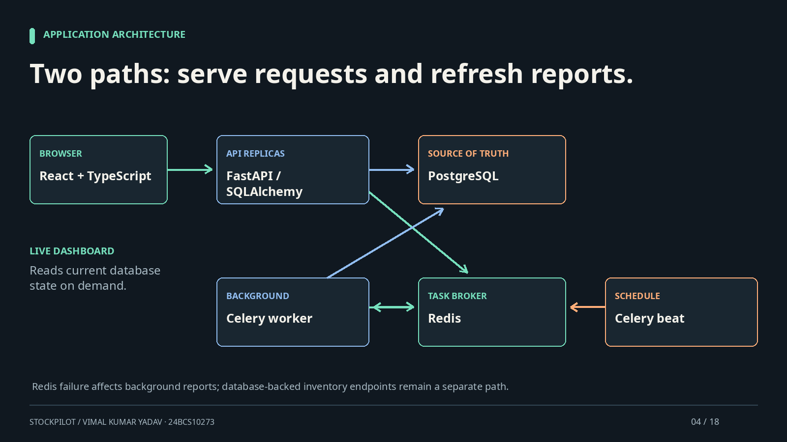
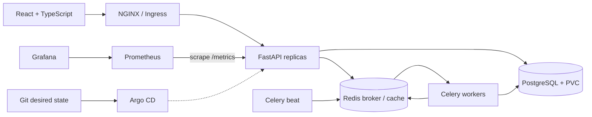
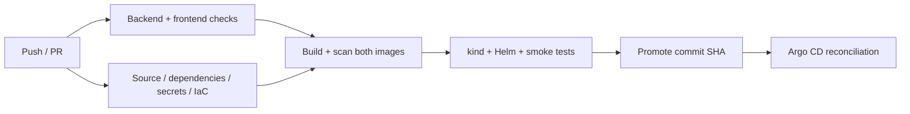

# StockPilot

**Inventory, engineered for operations.**

Vimal Kumar Yadav · 24BCS10273 · Session 21 DevOps capstone

StockPilot is an original **multi-warehouse inventory and procurement platform**. It manages supplier-linked products, physical stock, customer reservations, transfers and purchase orders. FastAPI and PostgreSQL enforce stock rules; React and TypeScript provide the operational workspace; Redis and Celery refresh reports in the background. The delivery platform includes Docker, Kubernetes, Helm, security gates, Prometheus/Grafana, Argo CD and Terraform.

[PowerPoint with notes](docs/presentation/StockPilot-Capstone.pptx) · [Presentation PDF](docs/presentation/StockPilot-Capstone.pdf) · [Narrated video](demo/StockPilot-Capstone-Narrated.mp4) · [Evidence](docs/evidence.md) · [Operations](docs/operations-guide.md)



*This is an original explanatory diagram, not a deployed-application screenshot. The video is a narrated technical walkthrough. Live browser/container/cluster/cloud capture is blocked in this execution environment; see the evidence register.*

## Product walkthrough

| Workspace | Behaviour |
|---|---|
| Overview | Inventory value, on-hand/reserved/available units, warehouse distribution, category mix, low-stock recommendations and recent movements |
| Inventory | Search and manage products, categories, suppliers, reorder thresholds and warehouse balances; export CSV |
| Movements | Receive, issue or transfer stock, with transaction-backed history and idempotent requests |
| Reservations | Reserve available units, release a reservation or fulfil it into a stock issue |
| Purchase orders | Create/edit multi-line drafts, place orders, receive all lines atomically or cancel valid states |
| Warehouses | Create warehouses and inspect network stock distribution |
| Suppliers | Manage supplier records and lead times while preserving references used by inventory history |
| Reports | Read live replenishment signals, queue a background snapshot and retrieve a timestamped cached report |

The interface includes responsive navigation, typed forms, search, validation, loading states and recoverable errors. Explicit demo seeding creates **8 products, 2 suppliers, 2 warehouses, 16 opening receipts and 931 units**. These are fictional examples.

## Rules beyond CRUD

**Available = on hand − reserved.** A transfer cannot consume units promised by a reservation. It updates both warehouses and records its movement in one transaction.

**Retries are explicit.** Movements and reservations carry unique idempotency keys and payload fingerprints. Identical retries return the existing result; conflicting reuse is rejected. Purchase receipts use deterministic movement keys.

**Lifecycles are constrained.** A draft order can be edited; an ordered order can be received; received orders cannot be edited or received twice. A closed reservation cannot change to a conflicting final state. Supplier and quantity validation belongs in the API and UI.

**Shared state lives in the database.** PostgreSQL row locks coordinate competing stock updates. Stable product lock ordering reduces deadlock risk. Unique keys, foreign keys and check constraints protect balances and history. SQLite tests verify rules but do not prove PostgreSQL concurrency behaviour.

## Architecture and stack



| Layer | Technology | Responsibility |
|---|---|---|
| Frontend | React, TypeScript, Vite, NGINX | Operational views, forms and API proxy |
| API | FastAPI, Pydantic, SQLAlchemy | Validated requests, stock rules and OpenAPI |
| Durable state | PostgreSQL 17, Alembic | Inventory ledger, relationships and migrations |
| Async work | Redis 7.4, Celery worker/beat | Reports; PostgreSQL remains authoritative |
| Packaging | Multi-stage Docker images, Compose | Reproducible service topology |
| Orchestration | Kubernetes, Helm | Replicas, probes, services, storage and scaling |
| Delivery | GitHub Actions, GHCR, Argo CD | Gates, SHA-tagged images and GitOps promotion |
| Monitoring | Prometheus, Grafana, JSON logs | Requests, latency, status codes and alerts |
| Cloud | Terraform, AWS VPC/EKS/EBS | Reviewable infrastructure and teardown |

Live reports query the database. Cached reports include a generation timestamp and expire after 180 seconds; Celery beat requests refreshes every 60 seconds. A Redis outage is reported by affected endpoints. Cached data never owns inventory truth.

## Run locally

From the repository root, with Docker and Compose available:

```bash
cp .env.example .env
# Edit .env: set POSTGRES_PASSWORD to a strong URL-safe value.
docker compose up --build -d
docker compose ps
```

| URL | Purpose |
|---|---|
| `http://localhost:3000` | Application |
| `http://localhost:8000/docs` | Interactive OpenAPI |
| `http://localhost:8000/health` | Process health |
| `http://localhost:8000/ready` | Database readiness |
| `http://localhost:8000/metrics` | Prometheus metrics |

Compose starts PostgreSQL, Redis, a migration/seed job, API, worker, scheduler and frontend. Migration must finish before the API starts. Ports bind to localhost. Named volumes preserve data across restarts. `docker compose down` stops services; adding `-v` deletes named volumes and their data. [The operations guide](docs/operations-guide.md) covers Python/Node development, tests and recovery.

## CI/CD and security



[The workflow](.github/workflows/ci.yml) defines seven jobs: backend, frontend, source security, infrastructure, images, deployment and promotion. Checks include Ruff, pytest/coverage, TypeScript/Vite, Bandit, Semgrep, pip-audit, npm audit, Gitleaks and Trivy IaC/image scanning. Image gates block HIGH/CRITICAL findings. Main-branch release images use Git commit SHA tags; pull requests validate changes without publishing or promotion.

The deployment job creates temporary kind infrastructure, installs Helm, tests the API and worker/cache path and cleans up. **A workflow file is not evidence of a successful hosted run.** No hosted CI execution or GHCR publication is claimed here.

Runtime controls include non-root application containers, restricted capabilities, resource limits, read-only filesystems where supported, explicit secrets and NetworkPolicies. The current product has **no sign-in or RBAC**; keep write APIs private for demonstrations. PostgreSQL and Redis are persistent single-instance demo services, not highly available database clusters. See [security boundaries](security/README.md).

## Kubernetes, monitoring and GitOps

The Helm chart defines two API, two frontend and two worker replicas, one scheduler, PostgreSQL and Redis PVCs, one migration job, ClusterIP Services, Ingress, ConfigMap/external Secret, probes, disruption budgets and NetworkPolicies. An API HPA targets 70% CPU with 2–8 replicas. HPA scales pods within available node capacity; automatic node scaling is separate.

The API exports HTTP request counters and duration histograms. Monitoring resources include a ServiceMonitor, four alerts and an eight-panel Grafana dashboard. JSON logs include method, route, status and elapsed time. [Monitoring instructions](monitoring/README.md) explain setup and verification.

[Argo CD configuration](gitops/README.md) connects the chart to Git-tracked release values and reconciliation. Actual Healthy/Synced status, drift recovery and live metric graphs remain runtime evidence to capture.

## Terraform and AWS boundary

Terraform defines a VPC, two public and two private subnets across two availability zones, EKS managed workers, KMS, EBS CSI/Pod Identity, API logs and VPC flow logs. The default avoids NAT charges by placing demo workers in public subnets with public IPs. NAT is opt-in and moves workers to private subnets; both choices and their limits are documented.

**AWS was not deployed.** No account access is available. Formatting and provider initialization completed; full validation was blocked by sandbox process communication. A real plan, apply, verification and teardown require an authorized account. Follow [the Terraform guide](terraform/README.md), including retained-storage cleanup. No production capacity, availability target or cloud cost estimate is claimed.

## Verified results and remaining evidence

| Area | Captured result | Boundary |
|---|---|---|
| Backend | **40 passed, 1 skipped; 97% coverage** | SQLite run; PostgreSQL concurrency case skipped |
| Migrations/seed | Upgrade/downgrade/upgrade and idempotent seed verified | Local SQLite execution |
| Source checks | Ruff passed; Bandit **0 findings**; Gitleaks **0 leaks** | [Final history validation](evidence/platform/final-history-validation.json); audit commit checked separately |
| Frontend | **13 component tests + TypeScript + production build passed** | jsdom component checks; browser execution not captured |
| Definitions | Helm lint/render, Compose config and actionlint passed; Trivy **0 unexcepted HIGH/CRITICAL** | Two documented demo IaC exceptions; no runtime deployment |
| Terraform | Formatting and provider initialization passed | Validate blocked; no AWS plan/apply |
| Presentation | 18-slide editable PPTX, PDF and narrated walkthrough | Original diagrams; no browser recording |
| Remote/runtime | Not claimed | Docker/socket/browser restrictions; no hosted CI/AWS |

[The evidence register](docs/evidence.md) links actual logs and explains their scope. [The screenshot index](screenshots/README.md) lists remaining captures. [The live demo runbook](demo/RUNBOOK.md) provides the product and platform sequence.

## Repository map

```text
backend/             FastAPI, models, migrations, workers and tests
frontend/            React/TypeScript UI and frontend image
docker-compose.yml   Seven-service local topology
helm/stockpilot/     Kubernetes chart and monitoring templates
k8s/                 Namespace and EKS storage configuration
terraform/           VPC, EKS, IAM, KMS and storage
.github/workflows/   Delivery/security pipeline
gitops/              Argo CD project, application and release values
monitoring/          Prometheus/Grafana instructions
security/            Tools and security boundaries
troubleshooting/     Seven deliberate failures and recovery exercises
scripts/             Tools, deployment and smoke/load helpers
evidence/            Actual check logs and reports
docs/                Operations, evidence and presentation
demo/                Video, transcript, captions and live runbook
screenshots/         Provenance and remaining capture checklist
```

## Lessons and next steps

Correct stock operations require transactions, validation and retry semantics together. Reservations represent business promises. Background caches should be disposable, and readiness should reflect whether a replica can serve database-backed work.

Next verification priorities are PostgreSQL concurrent testing, a live browser walkthrough, container/cluster execution, hosted security gates, GitOps reconciliation and monitoring evidence. Product extensions include authentication/RBAC, partial purchase receipts, audit identities and notifications. Capacity testing and database high availability are required before claiming production scale.

The [Session 21 project brief](https://github.com/Nency-Ravaliya/devops-heros/blob/main/session21-python/README.md) and [grading rubric](https://github.com/Nency-Ravaliya/devops-heros/blob/main/session21-python/GRADING.md) define the assignment requirements.

